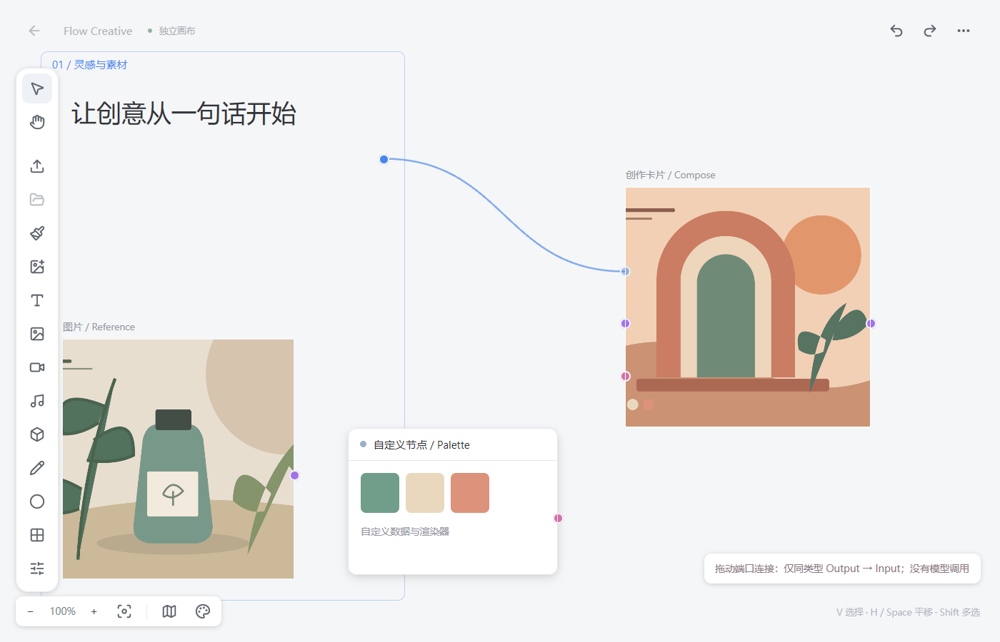
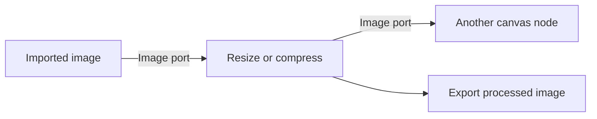

# gpui-flow

**English** · [简体中文](README.zh-CN.md) · [Documentation site](https://emojiiii.github.io/gpui-flow/)

gpui-flow is a Rust workspace for building native canvas apps with GPUI. It
includes **Flow Creative**, a local desktop workbench for arranging media and
connecting typed nodes on an infinite canvas, and reusable Rust crates for
building your own canvases.



## Run Flow Creative

Build from the repository root. CI pins Rust 1.98.1. See the
[setup guide](docs/getting-started.md) for the native dependencies on Windows,
macOS, and Ubuntu.

```sh
cargo run --locked -p gpui-flow-creative --features desktop --bin flow-creative
```

Create a project from the home screen, then drop a local image onto the canvas.
Projects save the canvas, viewport, and imported assets locally. Use
`--projects-dir ./projects` after Cargo's `--` separator to choose a project
directory.

To open the bundled sample canvas directly:

```sh
cargo run --locked -p gpui-flow-creative --features desktop --bin flow-creative -- --demo
```

## What you can do

- Arrange images, audio, video, and supported static GLB models on the canvas.
  Add text, shapes, or freehand strokes.
- Edit images in place, organize objects into layers and frames, and undo or redo edits.
- Export supported frame contents to PNG or SVG, or export local assets in
  their original format.
- Connect matching typed ports to pass inputs to image, video, audio, and model
  generation nodes. A host integration supplies the generation service. The
  bundled workbench runs without a provider.

For example, connect an image to a local processing node to resize or compress
it. The output can feed another node or be exported as a file.



See the [Flow Creative guide](docs/flow-creative.md) for canvas controls,
project storage, and media workflows. Format limits and host integration are
covered in the [detailed Chinese reference](crates/flow-creative/README.md).

## Build with gpui-flow

Use `gpui-flow` (`crates/flow-ui`) for the GPUI `FlowCanvas` and `SceneView`. Use
`gpui-flow-creative` for the workbench's `CreativeCanvas`, node registry, and
local project model. The graph and runtime can also run without a desktop
session.

| Workspace directories | Responsibility |
| --- | --- |
| `flow-core`, `flow-runtime` | Typed graphs, editing transactions, history, and task execution |
| `flow-scene`, `flow-engine` | Display objects, scene trees, lifecycles, and properties |
| `flow-layout`, `flow-animation` | Layout, timelines, and property animation |
| `flow-editor`, `flow-interaction` | Selection, transforms, input routing, and gestures |
| `flow-composite`, `flow-text`, `flow-media` | CPU compositing, text, and media |
| `flow-ui`, `flow-creative` | GPUI views and components, plus the desktop workbench |

The Rust APIs are in early development and may change. The scene and node
layers draw on Leafer and React Flow, respectively. See the
[Leafer compatibility profile](docs/leafer-compatibility-profile.md) for feature
coverage.

Try the graph API without opening a window:

```sh
cargo run --locked --manifest-path docs/examples/Cargo.toml --bin core
```

## Documentation

- **gpui-flow library** · [Start with a Rust example](docs/library.md)
- **Flow Creative app** · [Install and open your first project](docs/getting-started.md) · [Canvas workflows](docs/flow-creative.md)
- [Documentation index](docs/README.md)
- [Preview and publish the docs with GitHub Pages](docs/publishing.md)
