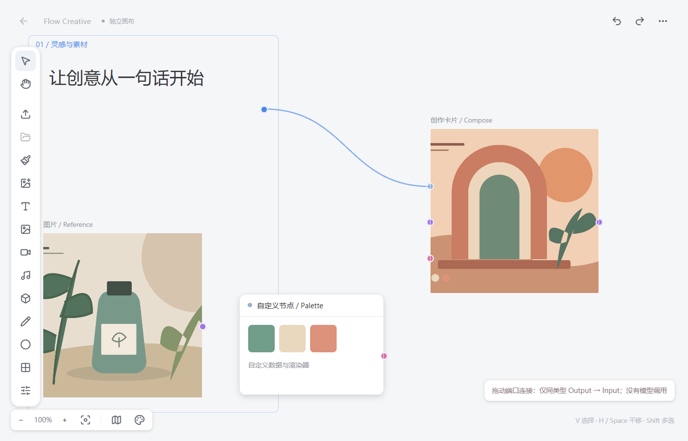

# gpui-flow

[English](README.md) · **简体中文** · [在线文档](https://emojiiii.github.io/gpui-flow/README.zh-CN/)

gpui-flow 是一个基于 Rust 和 GPUI 的原生画布工作区。它包含本地桌面创作工作台 **Flow Creative**，可以在无限画布上排布媒体、连接类型化节点，也提供可用于构建自定义画布的库。



## 启动 Flow Creative

在仓库根目录运行。CI 固定使用 Rust 1.98.1，Windows、macOS 和 Ubuntu 的原生依赖见[入门指南](docs/getting-started.zh-CN.md)。

```sh
cargo run --locked -p gpui-flow-creative --features desktop --bin flow-creative
```

从首页新建项目，再将本地图片拖入画布。项目会在本地保存画布、视口和导入的素材。要指定项目目录，可在 Cargo 的 `--` 分隔符后传入 `--projects-dir ./projects`。

直接打开内置示例画布：

```sh
cargo run --locked -p gpui-flow-creative --features desktop --bin flow-creative -- --demo
```

## 当前能力

- 在画布上排布图片、音频、视频和受支持的静态 GLB 模型，也可以添加文字、形状和自由笔迹。
- 就地编辑图片，用图层和画框组织对象，撤销或重做编辑。
- 将受支持的画框内容导出为 PNG 或 SVG，或按原格式导出本地素材。
- 连接同类型端口，为图片、视频、音频和模型生成节点提供输入。生成服务由宿主接入，内置工作台默认未连接服务。

例如，将图片连接到本地处理节点即可调整尺寸或压缩。输出可继续连到其他节点，也可导出为文件。


画布操作、素材处理和导出见 [Flow Creative 指南](docs/flow-creative.zh-CN.md)，格式限制与宿主接入见[详细参考](crates/flow-creative/README.md)。

## 在应用中复用

`gpui-flow`（`crates/flow-ui`）提供 GPUI 的 `FlowCanvas` 和 `SceneView`。`gpui-flow-creative` 提供工作台使用的 `CreativeCanvas`、节点注册表和本地项目模型。图模型和运行时可在无桌面环境中使用。

| 工作区目录 | 职责 |
| --- | --- |
| `flow-core`、`flow-runtime` | 类型化图、编辑事务、历史与任务执行 |
| `flow-scene`、`flow-engine` | 显示对象、场景树、生命周期与属性 |
| `flow-layout`、`flow-animation` | 布局、时间线与属性动画 |
| `flow-editor`、`flow-interaction` | 选择、变换、输入路由与手势 |
| `flow-composite`、`flow-text`、`flow-media` | CPU 合成、文字与媒体 |
| `flow-ui`、`flow-creative` | GPUI 视图与组件、桌面工作台 |

项目仍处于早期开发阶段，Rust API 可能调整。场景层参考 Leafer，节点层参考 React Flow。功能覆盖范围见 [Leafer 兼容性说明](docs/leafer-compatibility-profile.md)。

无需打开窗口即可试用图模型 API：

```sh
cargo run --locked --manifest-path docs/examples/Cargo.toml --bin core
```

## 文档

- **gpui-flow 库** · [从 Rust 示例开始](docs/library.zh-CN.md)
- **Flow Creative 工作台** · [安装并创建首个项目](docs/getting-started.zh-CN.md) · [画布工作流](docs/flow-creative.zh-CN.md)
- [文档索引](docs/README.zh-CN.md)
- [本地预览文档与发布到 GitHub Pages（英文）](docs/publishing.md)
