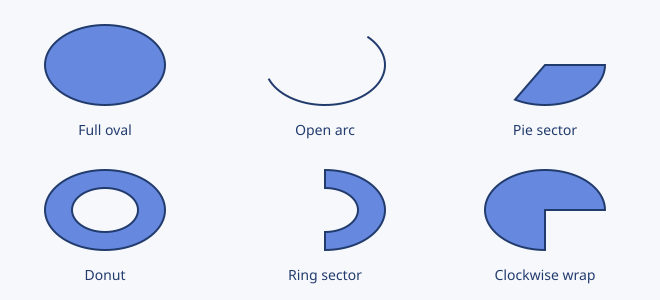

# Ellipse arcs, pies and rings

`flow-scene/src/display/ellipse.rs` now owns real partial-ellipse and inner-ring
geometry. The same generated curves feed retained bounds, hit testing, strokes,
the generic native vector adapter and the CPU compositor. This is a component
extension, not a renamed Path wrapper or a full Leafer API compatibility claim.

The gallery is emitted by `cargo run -p gpui-flow-scene --example ellipse_gallery`.
It uses each Ellipse's actual `to_path()` output, not hand-drawn diagram geometry.

## Pinned source and chosen semantics

References: upstream [Ellipse component](https://github.com/leaferjs/leafer-ui/blob/1e11641d3ea6b0211c83447268a90b8d58feec25/packages/display/src/Ellipse.ts),
[UI closed default](https://github.com/leaferjs/leafer-ui/blob/1e11641d3ea6b0211c83447268a90b8d58feec25/packages/display/src/UI.ts),
and [core arc conversion](https://github.com/leaferjs/leafer/blob/1d703303ff0759ce4973d54c87eeb8192dddc570/packages/path/src/BezierHelper.ts).
The implementation uses Kurbo for arc geometry.

- Existing `Ellipse::new(width, height)` / `circle(radius)` still make a full oval.
  Old JSON containing only `size` defaults to `start_angle=0`, `end_angle=0`,
  `inner_radius=0`, `closed=true`. The existing default full-oval analytic hit,
  bounded polygon generation and tiny-skia oval fast paths remain unchanged.
- `.arc(start, end)` sets angles and `closed=false`; `.sector(start, end)` closes
  a pie sector through the center. Angles are degrees, 0 points right, and outer
  sweeps are clockwise in positive-y scene coordinates.
- `.ring(ratio)` uses inner radii proportional to the outer radii. Full rings use
  opposite-winding separate contours; partial rings connect the outer arc to a
  reversed inner arc. For `0 < ratio < 1`, that strip is closed even when the
  outer `closed` flag is false, matching the referenced component's branch.
- `ratio=1` with `closed=false` keeps only the outer arc. With `closed=true` the
  coincident reversed boundary has no filled interior. Ratios outside [0,1] reject.
- An open arc with a fill still fills the implicitly closed endpoint chord, as
  existing Path filling does. Use `fill=None` for a stroke-only arc. Its stroke
  does not invent radial edges; a pie sector does include those edges.
- Negative start angles and wrapped clockwise spans are supported. For example,
  `-90 -> 0` is an upper-right quarter and `90 -> 0` is a clockwise 270-degree arc.
- Both zero angles are the upstream full-oval sentinel. Other equal angles
  explicitly produce empty geometry. Spans of exactly +360 or -360 canonicalize
  to one clockwise full turn. These degenerate/full-turn conventions are explicit
  Rust choices; backend-dependent/one-step normalization quirks in the pinned
  JavaScript helper are not claimed as exact parity.

## Bounds, rendering and editing

`bounds()` remains the nominal sizing rectangle. `geometry_bounds()` reports the
actual generated curve/sector geometry (None for an empty span), and
`Shape::local_bounds` uses those real geometry bounds. Arc bounds are not a fake
full-oval rectangle. Curve bounds come from the existing Path/Kurbo extrema code.

`to_path()` returns normalized absolute curves. CPU compositing routes nondefault
ellipses through those commands instead of its old unconditional oval shortcut.
Native vector preparation already consumes every `Shape::flatten` contour; inner
holes are not silently discarded. Fill rules, clipping, paints, masks, shadows,
advanced strokes and resource limits retain their existing pipeline contracts.
Open arcs continue to reject inside/outside aligned strokes, as other open paths do.

Use the existing `PropertyKey::Shape` transaction to change an Ellipse. Engine
changes invalidate geometry/paint/hit data and ancestor bounds/damage atomically;
editor changes participate in the existing Undo/Redo and grouped cancellation.

Rust migration: `Ellipse::flatten(tolerance)` now returns `Vec<Contour>` so a ring
can return both boundaries. Custom geometry factories should use
`(ellipse.bounds(), ellipse.flatten(tolerance))` instead of wrapping the result in
another vector. A factory whose layout should follow a partial arc should use its
`geometry_bounds()` and handle empty geometry explicitly. Existing repository
factory examples/tests were migrated. New public fields also require updating
external exhaustive Ellipse struct literals; constructors avoid that issue.

## Bounds on work

Nondefault arcs/rings require positive dimensions at most 1000000 local units,
finite angles within +/-1000000 degrees and raw angle differences at most 360.
Conversion uses Kurbo's 0.01 local-unit cubic tolerance with at most 64 commands.
Curve flattening has a seven-level subdivision bound and at most 8192 points;
very large/zoomed shapes do not promise subpixel precision beyond that cap.
Default full-oval flattening retains its existing 4096-point cap. Legacy large
full-oval sizing stays accepted, but explicit `to_path()` conversion enforces the
new conversion size ceiling. Invalid/oversized geometry is rejected at validated
scene mutation boundaries rather than partially committed.

## Validation

Fresh Linux/Rust 1.98.1 validation on 2026-10-02:

- 25 new regressions pass: 13 scene geometry, 4 engine, 2 editor and 6 CPU pixel
  tests. They cover legacy JSON/default oval equality, clockwise/negative/wrapped
  angles, real arc bounds, open-chord versus pie fill, ring holes and winding,
  annular sectors, degenerate spans, point budgets, invalid updates, ancestor
  bounds/damage/hit invalidation, JSON, Undo/Redo and cancellation.
- Eight headless crates (`core`, `scene`, `engine`, `editor`, `composite`, `text`,
  `layout`, `animation`): 806 tests including doctests pass, zero failures, one
  existing ignored radial-raster performance benchmark. Strict Clippy
  `--all-targets -- -D warnings`, workspace rustfmt and `git diff --check` pass.
- The executable SVG gallery ran successfully, its six paths were checked, and
  its rendered image was visually inspected. This is generated component geometry,
  not a screenshot of a native app.

Validation used a temporary eight-member headless workspace with matching source,
examples and tests. Retained external package versions/checksums match the
unchanged repository lockfile. In the copied `flow-text` manifest only, the unused
optional native GPUI dependency was removed (its feature was not enabled), so
Cargo did not need to resolve the unrelated native repository. Repository
manifests/lockfiles and Rust source were not changed for that validation route.

Full workspace/native UI/cross-platform checks were not rerun. The generic native
adapter's source consumes the shared contours, but no native window or GPU
backend was exercised in this slice. No GitHub Actions, deployment or merge was
launched.

Factory follow-up: the [Rect corner slice](rect-corners.md#validation) also added
the Ellipse angle/ring fields to the built-in registry schema, with explicit
factory/default/invalid-input tests. Constructors and direct Shape edits already
used those fields; factory creation now exposes the same validated behavior.
