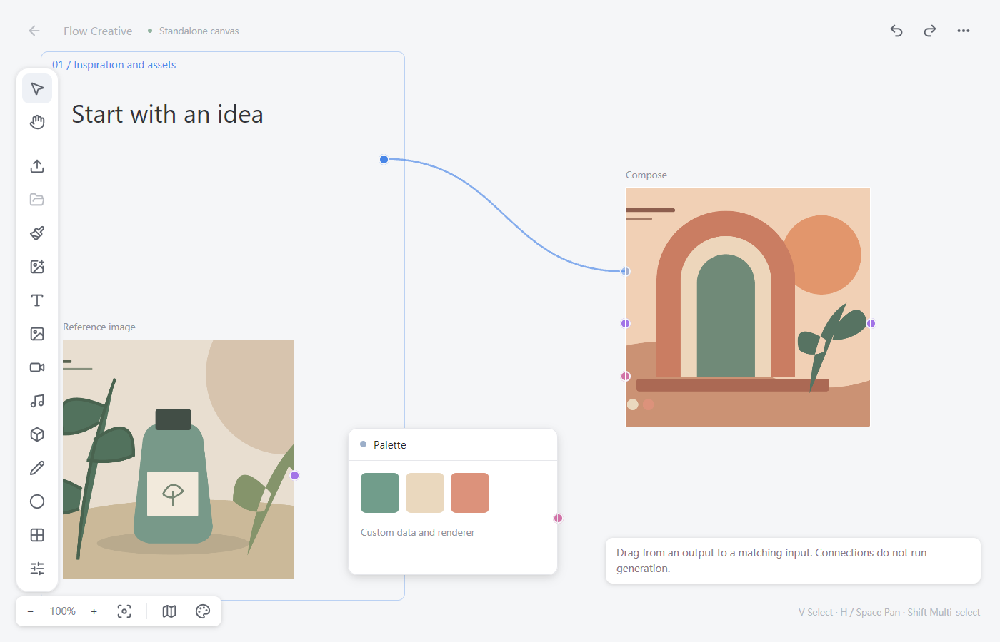
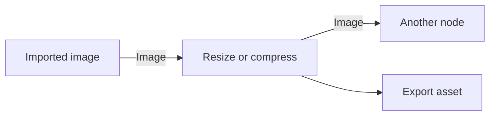

# Flow Creative

[Documentation](README.md) · [简体中文](flow-creative.zh-CN.md)

Arrange local media, text, and drawings on a canvas, or connect typed nodes to process assets. Install the desktop app and make your first project with the [quickstart](getting-started.md).

## Create and reopen a project

Click the project name at the top of the canvas to rename it. Use the upper-left arrow to return to the project home, where you can search and reopen projects by name.

Local projects keep `project.json` and copies of imported assets in the project folder. The media processing and export steps below use a local project. The `--demo` and `--file` modes open standalone canvases. See [project locations](getting-started.md#choose-where-projects-are-saved).

## Navigate and edit the canvas

The built-in demo shows the tool rail on the left and zoom and fit controls at the bottom left.

### Canvas controls and shortcuts

| Task | Control |
| --- | --- |
| Select or move | **V**, then click or drag. Hold **Shift** to select multiple objects. |
| Pan or zoom | **H** for the hand tool or **Space** + drag. Use **−** and **+** to zoom, or the fit icon beside them to bring all objects into view. |
| Add text | **T**, then click or drag. Double-click existing text to edit it. |
| Draw | **F** for a frame or **P** for freehand strokes. Use the shape menu for rectangles, ellipses, and lines. |
| Manage layers | Use the stacked layers icon on the left toolbar to reorder, hide, or lock objects. |
| Undo or redo | Use the curved arrows at the top of the canvas. |

Select an object to reveal its floating edit controls. Static PNG and JPEG images support cropping, rotation, flipping, and color adjustment.

## Bring in local media

Drop files onto the canvas to place them at the pointer. Use the folder icon on the left to reuse project assets.

| Source format | Canvas use |
| --- | --- |
| PNG, JPEG, GIF, WebP | Place at the original aspect ratio and resize on the canvas. |
| MP4, WebM | Play, pause, or seek with the selected object's controls. |
| WAV, MP3, FLAC, OGG, M4A | Play, pause, or seek with waveform and timeline controls. |
| Supported static GLB | Preview the embedded mesh and orbit the viewpoint. |

Install [FFmpeg tools](getting-started.md#optional-media-tools) for audio and video. See the [full media and model reference (Chinese)](../crates/flow-creative/README.md#按任务查阅).

## Connect nodes and process an image

An **Image** output connects to an **Image** input.

1. Select an imported PNG or JPEG and click the sliders icon in its floating toolbar. This adds an image processing node already connected to the image.
2. Select the processing node. Choose PNG or JPEG and a longest-edge preset, then use the run button at the bottom of its settings panel.
3. Use the new asset as input to another node or export it with the download icon. The original stays in the project. Run processing again after changing an input or setting.

You can also drag a connection from an output to a matching input. Local processing runs in the desktop app. Generation nodes require a service supplied by the host application.

## Export a frame or an asset

Press **F** and drag around the visible, unlocked, ungrouped objects you want to export. Select the frame's title, then use the download icon above it. Save to a new file outside the project folder.

| Export | Supported selection |
| --- | --- |
| Frame PNG | One frame with static PNG/JPEG images, text, shapes, or strokes, clipped to the frame bounds. |
| Frame SVG | One frame with shapes or freehand strokes as its visible members. |
| Standalone SVG | One or more selected shapes or strokes on a transparent background. |
| Original asset | A file from the project asset panel or a node with a valid media output. |

For format and size limits, see the [export reference (Chinese)](../crates/flow-creative/README.md#素材导出).

To embed or extend a canvas, see the [library guide](library.md#embed-a-canvas-in-your-app).
