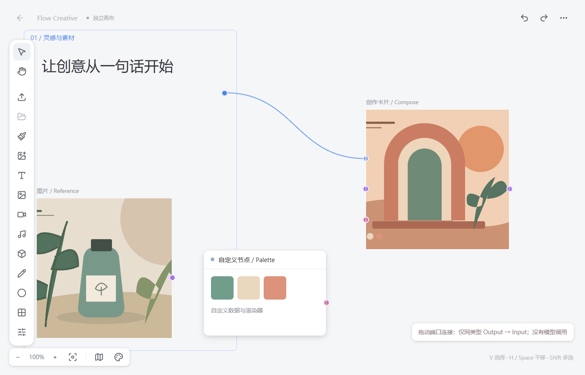
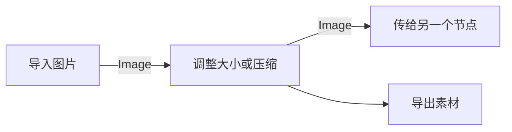

# Flow Creative 使用指南

[文档目录](README.zh-CN.md) · [English](flow-creative.md)

在画布上排布本地素材、文字和图形，或连接类型化节点处理素材。安装桌面应用和创建第一个项目见[入门指南](getting-started.zh-CN.md)。

## 创建与重新打开项目

点击画布顶部的项目名称可重命名。用左上角的箭头返回首页，可按名称搜索并重新打开项目。

本地项目目录会保存 `project.json` 和导入素材的副本。下文的处理和导出操作在本地项目中完成。`--demo` 和 `--file` 会打开独立画布。参见[项目存放位置](getting-started.zh-CN.md#选择项目存放位置)。

## 画布导航与编辑

工具栏在左侧，缩放和适应画布的控件位于左下角。

### 画布控件与快捷键

| 操作 | 控件 |
| --- | --- |
| 选择或移动 | 按 **V** 后点击或拖动，按住 **Shift** 多选。 |
| 平移或缩放 | 按 **H** 切换手形工具，或按住 **Space** 拖动。用 **−** 和 **+** 缩放，点击旁边的适应按钮显示全部对象。 |
| 添加文字 | 按 **T** 后点击或拖动。双击已有文字可编辑。 |
| 绘制 | 按 **F** 画框，按 **P** 自由绘制。用图形菜单绘制矩形、椭圆或线条。 |
| 管理图层 | 打开左侧**图层**，可调整顺序、隐藏或锁定对象。 |
| 撤销或重做 | 使用画布顶部的弯箭头。 |

选中对象后会显示浮动工具。静态 PNG 和 JPEG 支持裁剪、旋转、翻转和调色。

## 导入素材

将文件拖到画布上的目标位置。用左侧文件夹按钮打开**本项目素材**，可复用已导入的文件。

| 文件格式 | 画布操作 |
| --- | --- |
| PNG、JPEG、GIF、WebP | 按原比例放置并调整显示大小。 |
| MP4、WebM | 选中后播放、暂停或跳转。 |
| WAV、MP3、FLAC、OGG、M4A | 使用波形和时间轴播放、暂停或跳转。 |
| 受支持的静态 GLB | 预览内嵌网格并旋转视角。 |

音视频功能需要 [FFmpeg 工具](getting-started.zh-CN.md#可选的媒体工具)。更多格式和模型细节见[完整手册](../crates/flow-creative/README.md#按任务查阅)。

## 连线与图片处理

**Image** 类型的输出连接到同类型输入。

1. 选中已导入的 PNG 或 JPEG，点击浮动工具栏的**创建本地处理节点**，新节点会自动连到图片。
2. 选中处理节点，选择 PNG 或 JPEG 及最长边预设，然后点击**运行处理**。
3. 将新素材连接给另一个节点，或用下载按钮导出。项目会保留原图。输入或参数变更后，重新运行处理。

也可将输出端口拖到匹配的输入端口手动连线。本地处理在桌面应用中运行，生成节点需要宿主接入服务。

## 导出画框或素材

按 **F** 框住所需的可见、未锁定、未编组对象。选中画框标题，点击上方的下载按钮，在项目目录之外保存新文件。

| 导出类型 | 支持的内容 |
| --- | --- |
| 画框 PNG | 一个包含静态 PNG/JPEG、文字、图形或笔迹的画框，按画框边界裁切。 |
| 画框 SVG | 一个可见成员为图形或自由笔迹的画框。 |
| 独立 SVG | 一个或多个选中的图形或笔迹，背景透明。 |
| 原始素材 | 本项目素材中的文件，或有有效媒体输出的节点。 |

具体格式与尺寸限制见[导出参考](../crates/flow-creative/README.md#素材导出)。

要嵌入或扩展画布，参阅[库指南](library.zh-CN.md#在宿主应用中嵌入画布)。
