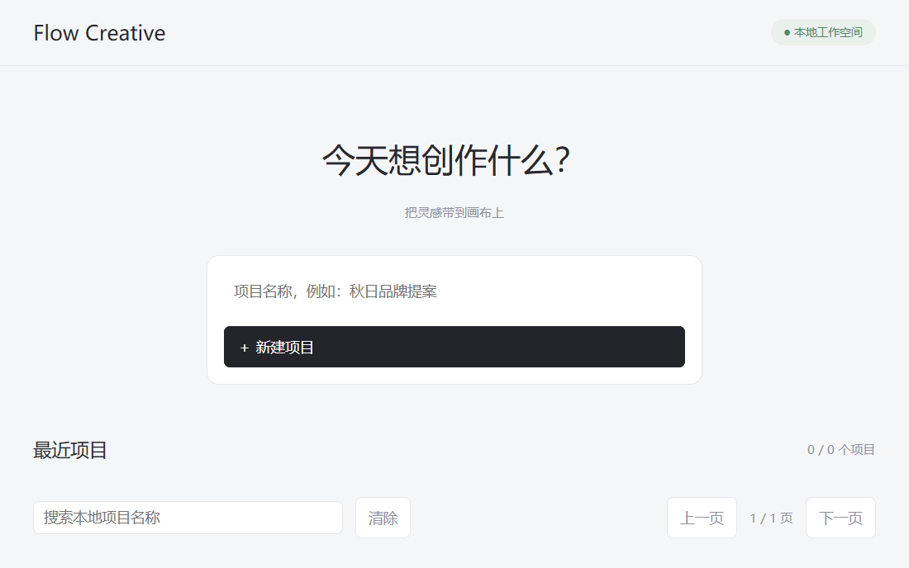

# Getting started

[Documentation](README.md) · [简体中文](getting-started.zh-CN.md)

## Set up the build

Select the Rust toolchain used by CI from the repository root.

```sh
rustup toolchain install 1.98.1 --component rustfmt --component clippy
rustup override set 1.98.1
```

The first build may need network access to fetch the dependencies pinned in `Cargo.lock`.

### Ubuntu 24.04

```sh
sudo apt-get update
sudo apt-get install -y \
  build-essential pkg-config clang libclang-dev \
  libasound2-dev libfontconfig-dev libfreetype-dev libssl-dev \
  libvulkan1 mesa-vulkan-drivers libwayland-dev \
  libx11-xcb-dev libxcb1-dev libxkbcommon-dev libxkbcommon-x11-dev \
  libzstd-dev
```

Run the workbench in a desktop session with a working graphics backend.

### Windows

Use Git, the MSVC Rust toolchain, and Visual Studio 2022 Build Tools with the **Desktop development with C++** workload and Windows SDK.

### macOS

Install the Xcode Command Line Tools.

```sh
xcode-select --install
```

For Metal or SDK build errors, check the selected Xcode with `xcode-select -p`. Some SDK configurations require full Xcode.

### Optional media tools

Put `ffmpeg`, `ffprobe`, and `ffplay` on `PATH` for local audio and video.

## Open Flow Creative

```sh
cargo run --locked -p gpui-flow-creative --features desktop --bin flow-creative
```

The desktop app currently displays its controls in Chinese.



1. Enter a project name and click the **+** button below the name field.
2. Drag a local PNG or JPEG from your file manager onto the blank canvas.
3. Press **T** with the canvas focused, click the canvas, then type a caption. Press **Esc** when done.
4. Use the back arrow in the upper-left corner and reopen the project to see the saved canvas.

To open the built-in demo, run the same command with `--demo` after Cargo's `--` separator.

```sh
cargo run --locked -p gpui-flow-creative --features desktop --bin flow-creative -- --demo
```

See the [demo screenshot and canvas controls](flow-creative.md#navigate-and-edit-the-canvas).

## Choose where projects are saved

| Platform | Default project directory |
| --- | --- |
| Linux | `$XDG_DATA_HOME/gpui-flow/projects`, or `~/.local/share/gpui-flow/projects` |
| macOS | `~/Library/Application Support/Flow Creative/Projects` |
| Windows | `%LOCALAPPDATA%/Flow Creative/Projects` |

To change where the app looks for projects, pass `--projects-dir` after Cargo's `--` separator.

```sh
cargo run --locked -p gpui-flow-creative --features desktop --bin flow-creative -- --projects-dir ./projects
```

Use `--file ./board.flow.json` to open a standalone `FlowDocument` containing a graph and viewport. For project asset storage, see the [Flow Creative guide](flow-creative.md#create-and-reopen-a-project).

<a id="run-examples-without-a-desktop-session"></a>
<a id="embed-a-canvas-in-your-app"></a>

For library development, [run headless examples](library.md#run-examples-without-a-desktop-session) or [embed a canvas in your app](library.md#embed-a-canvas-in-your-app).
