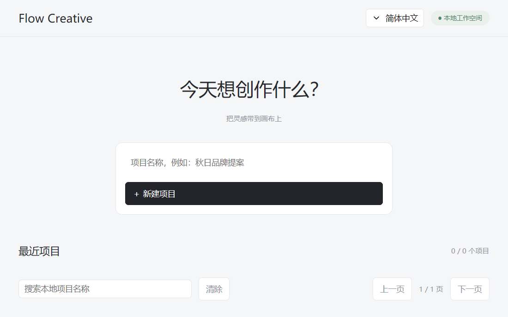

# 环境准备与入门

[文档目录](README.zh-CN.md) · [English](getting-started.md)

## 准备构建环境

在仓库根目录选择 CI 使用的 Rust 工具链。

```sh
rustup toolchain install 1.98.1 --component rustfmt --component clippy
rustup override set 1.98.1
```

首次构建可能需要联网下载 `Cargo.lock` 锁定的依赖。

### Ubuntu 24.04

```sh
sudo apt-get update
sudo apt-get install -y \
  build-essential pkg-config clang libclang-dev \
  libasound2-dev libfontconfig-dev libfreetype-dev libssl-dev \
  libvulkan1 mesa-vulkan-drivers libwayland-dev \
  libx11-xcb-dev libxcb1-dev libxkbcommon-dev libxkbcommon-x11-dev \
  libzstd-dev
```

在图形后端可用的桌面会话中运行工作台。

### Windows

使用 Git、MSVC Rust 工具链，以及安装了**使用 C++ 的桌面开发**工作负载和 Windows SDK 的 Visual Studio 2022 Build Tools。

### macOS

安装 Xcode Command Line Tools。

```sh
xcode-select --install
```

出现 Metal 或 SDK 构建错误时，用 `xcode-select -p` 检查所选工具链。部分 SDK 配置需要完整的 Xcode。

### 可选的媒体工具

Flow Creative 优先使用 `PATH` 中的 `ffmpeg`、`ffprobe` 和 `ffplay`。Windows 缺少播放所需的工具时，会通过 Media Foundation 播放受支持的 H.264 MP4 和 AAC 伴音。WebM、独立音频和媒体转码使用外部工具。macOS 和 Linux 的音视频功能也使用这套工具。

## 启动 Flow Creative

```sh
cargo run --locked -p gpui-flow-creative --features desktop --bin flow-creative
```

项目首页右上角可以切换简体中文和 English。应用会记住上次选用的语言。



1. 输入项目名称，点击**新建项目**。
2. 从文件管理器将本地 PNG 或 JPEG 拖入空白画布。
3. 在画布获得焦点时按 **T**，点击放置文字后输入内容，按 **Esc** 结束。
4. 点左上角返回箭头，再打开项目，即可看到保存的画布。

在 Cargo 的 `--` 分隔符后传入 `--demo`，即可打开内置示例。

```sh
cargo run --locked -p gpui-flow-creative --features desktop --bin flow-creative -- --demo
```

查看[示例截图与画布操作](flow-creative.zh-CN.md#画布导航与编辑)。

## 选择项目存放位置

| 平台 | 默认项目目录 |
| --- | --- |
| Linux | `$XDG_DATA_HOME/gpui-flow/projects`，或 `~/.local/share/gpui-flow/projects` |
| macOS | `~/Library/Application Support/Flow Creative/Projects` |
| Windows | `%LOCALAPPDATA%/Flow Creative/Projects` |

使用 `--projects-dir` 在指定目录打开项目首页。

```sh
cargo run --locked -p gpui-flow-creative --features desktop --bin flow-creative -- --projects-dir ./projects
```

使用 `--file ./board.flow.json` 打开包含图与视口的独立 `FlowDocument`。素材与项目的保存方式见 [Flow Creative 指南](flow-creative.zh-CN.md#创建与重新打开项目)。

<a id="在无桌面环境运行示例"></a>
<a id="在宿主中嵌入画布"></a>

使用 gpui-flow 库进行开发时，可参阅[无桌面示例](library.zh-CN.md#在无桌面环境运行示例)与[画布嵌入指南](library.zh-CN.md#在宿主应用中嵌入画布)。
