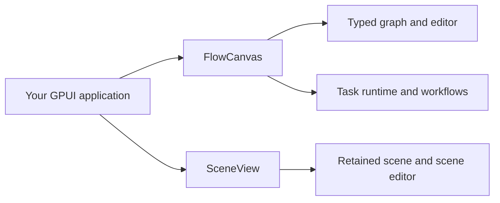

# gpui-flow

<a id="gpui-flow-sdk"></a>

[简体中文](library.zh-CN.md) · [Documentation](README.md) · [Flow Creative](flow-creative.md)

Build a native node editor or retained scene editor inside your own Rust / GPUI
application. Use the same libraries for headless graph editing and workflow
execution. The Flow Creative desktop workbench is built on gpui-flow.

## Build a typed graph

The workspace CI uses Rust 1.98.1. To use the graph model in your own Cargo
project, add `gpui-flow-core` as a path dependency. This path assumes your
project and the gpui-flow checkout are siblings.

```toml
[dependencies]
gpui-flow-core = { path = "../gpui-flow/crates/flow-core" }
```

Save this example as `src/main.rs` and run `cargo run` in your project. The
connection matches a numeric output to a numeric input. `Editor` saves the graph
and viewport as a document you can restore.

```rust
use gpui_flow_core::{DataType, Editor, Graph, GraphError, Node, Point, Port, PortRef};

fn main() -> Result<(), GraphError> {
    let mut graph = Graph::new();
    graph.add_node(
        Node::new("source", "Source", Point::new(40.0, 60.0))
            .with_port(Port::output("value", "Value", DataType::Number)),
    )?;
    graph.add_node(
        Node::new("sink", "Sink", Point::new(360.0, 60.0))
            .with_port(Port::input("value", "Value", DataType::Number)),
    )?;
    graph.connect(
        "source-to-sink",
        PortRef::new("source", "value"),
        PortRef::new("sink", "value"),
    )?;

    let editor = Editor::new(graph)?;
    let restored = Editor::from_json(&editor.to_json()?)?;
    assert_eq!(restored.document(), editor.document());
    println!("Graph document round-trip passed.");
    Ok(())
}
```

Use `Editor` transactions for graph edits and undo/redo. Use
`gpui-flow-runtime` to execute registered runners. Its `Runtime` handles
independent tasks, and `Workflow` schedules a validated directed acyclic graph
and passes values along its ports.

## Run examples without a desktop session

From the repository root, run the examples in their standalone Cargo workspace.
They use local Rust fixtures and need no desktop session or provider credentials.

```sh
cargo run --locked --manifest-path docs/examples/Cargo.toml --bin core
cargo run --locked --manifest-path docs/examples/Cargo.toml --bin runner
cargo run --locked --manifest-path docs/examples/Cargo.toml --bin workflow
```

The graph example validates editing, undo/redo, clipboard operations, and a
document round trip. The workflow example prints `HELLO CANVAS` after passing
text through two runners. Find more binaries in the [example sources](examples/src/bin/).

## Embed a canvas in your app

Add `gpui-flow = { path = "../gpui-flow/crates/flow-ui" }` to use the native
views in a sibling Cargo project. The package also exports standalone controls
such as `NodeFrame`, `PortHandle`, and `MiniMap`.



- Start with `FlowCanvas` for typed nodes and edges. Register your own
  `NodeRenderer` implementations with `NodeRegistry`, and attach runners when
  your application needs execution.
- Start with `SceneView` for retained visual objects. Its `Scene` and
  `SceneEditor` support a display tree and editing operations.
- Use `gpui-flow-creative` with its `desktop` feature when the host needs
  `CreativeCanvas` and the workbench's object definitions. `ProjectStore`
  provides local project storage in that crate. The
  [workbench reference](creative-reference.en.md#embed-flow-creative)
  describes host integration.

Use the same GPUI and gpui-kit sources and revisions as the workspace. After
initializing the host, construct `FlowCanvas::new(graph, cx)` or
`SceneView::new(scene, cx)` in a GPUI entity. See [platform dependencies](getting-started.md)
and the [desktop entry point](../crates/flow-creative/src/main.rs) for initialization.

<a id="sdk-reference"></a>

## Reference

| Goal | Reference | Example binary |
| --- | --- | --- |
| Model, validate, and edit a node graph | [Graph architecture](architecture.en.md) · [Core crate](../crates/flow-core/README.md) | `core` |
| Render custom nodes and compose GPUI components | [Custom nodes](custom-nodes.en.md) · [GPUI components](components.en.md) | |
| Execute independent tasks or a connected graph | [Workflows and runners](workflows.en.md) | `runner`, `workflow` |
| Build and edit a retained scene | [Display scenes](display-scenes.en.md) · [Scene crate](../crates/flow-scene/README.md) | `layout`, `animation` |
| Add input, tools, and editor behavior | [Custom scene tools](custom-tools.md) | `plugins` |

Use the [scene reference index](README.md#scene-reference) for rendering,
export, text, layout, and accessibility. See [local validation](testing.en.md)
for checks by crate.
