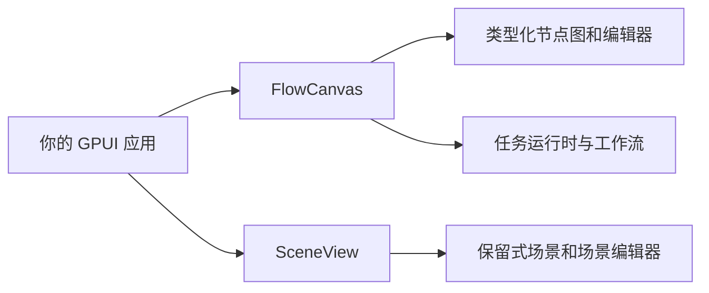

# gpui-flow

<a id="gpui-flow-sdk"></a>

[English](library.md) · [文档目录](README.zh-CN.md) · [Flow Creative](flow-creative.zh-CN.md)

在自己的 Rust / GPUI 应用中构建原生节点编辑器或保留式场景编辑器。gpui-flow 也可用于
命令行和服务中的图编辑与工作流执行。Flow Creative 桌面工作台基于这些库构建。

## 创建类型化节点图

工作区 CI 使用 Rust 1.98.1。要在自己的 Cargo 项目中使用图模型，可将
`gpui-flow-core` 添加为路径依赖。以下路径假设你的项目与 gpui-flow 源码目录位于同一层。

```toml
[dependencies]
gpui-flow-core = { path = "../gpui-flow/crates/flow-core" }
```

将示例保存为 `src/main.rs`，在项目中运行 `cargo run`。这里将数字输出端口连接到
数字输入端口，并通过 `Editor` 将图和视口保存为可恢复的文档。

```rust
use gpui_flow_core::{DataType, Editor, Graph, GraphError, Node, Point, Port, PortRef};

fn main() -> Result<(), GraphError> {
    let mut graph = Graph::new();
    graph.add_node(
        Node::new("source", "Source", Point::new(40.0, 60.0))
            .with_port(Port::output("value", "Value", DataType::Number)),
    )?;
    graph.add_node(
        Node::new("sink", "Sink", Point::new(360.0, 60.0))
            .with_port(Port::input("value", "Value", DataType::Number)),
    )?;
    graph.connect(
        "source-to-sink",
        PortRef::new("source", "value"),
        PortRef::new("sink", "value"),
    )?;

    let editor = Editor::new(graph)?;
    let restored = Editor::from_json(&editor.to_json()?)?;
    assert_eq!(restored.document(), editor.document());
    println!("Graph document round-trip passed.");
    Ok(())
}
```

通过 `Editor` 事务提交图编辑并实现撤销和重做。通过 `gpui-flow-runtime` 执行已注册的
runner。`Runtime` 处理独立任务，`Workflow` 调度经验证的有向无环图，并沿端口传递数据。

## 在无桌面环境运行示例

从仓库根目录运行独立 Cargo 工作区中的示例。示例使用本地 Rust 测试数据，
无需桌面会话或服务凭据。

```sh
cargo run --locked --manifest-path docs/examples/Cargo.toml --bin core
cargo run --locked --manifest-path docs/examples/Cargo.toml --bin runner
cargo run --locked --manifest-path docs/examples/Cargo.toml --bin workflow
```

图模型示例验证编辑、撤销重做、剪贴板操作和文档恢复。工作流示例将文本传递给两个
runner，并输出 `HELLO CANVAS`。更多程序见[示例源码](examples/src/bin/)。

## 在宿主应用中嵌入画布

在同级 Cargo 项目中添加 `gpui-flow = { path = "../gpui-flow/crates/flow-ui" }`
即可使用原生视图。该包还提供 `NodeFrame`、`PortHandle` 和 `MiniMap` 等独立控件。



- 类型化节点和连线使用 `FlowCanvas`。通过 `NodeRegistry` 注册自定义
  `NodeRenderer`，需要执行任务时再接入 runner。
- 保留式视觉对象使用 `SceneView`，其 `Scene` 和 `SceneEditor` 提供显示树与编辑操作。
- 需要 `CreativeCanvas` 和工作台对象定义时，为 `gpui-flow-creative` 启用 `desktop`
  feature。该 crate 的 `ProjectStore` 提供本地项目存储。宿主接入详见
  [工作台扩展参考](../crates/flow-creative/README.md#可复用-api-与验证)。

使用与工作区相同来源和版本的 GPUI 与 gpui-kit。初始化宿主后，在 GPUI 实体中通过
`FlowCanvas::new(graph, cx)` 或 `SceneView::new(scene, cx)` 创建视图。参见
[平台依赖](getting-started.zh-CN.md)和[桌面入口源码](../crates/flow-creative/src/main.rs)中的初始化。

<a id="sdk-参考"></a>

## 参考

| 目标 | 参考文档 | 示例程序 |
| --- | --- | --- |
| 建模、验证和编辑节点图 | [Core crate（英文）](../crates/flow-core/README.md) · [图架构](architecture.md) | `core` |
| 渲染自定义节点并组合 GPUI 控件 | [自定义节点](custom-nodes.md) · [GPUI 组件](components.md) | |
| 执行独立任务或相连的节点图 | [运行时与 runner](runtime.md) · [工作流调度](workflows.md) | `runner`、`workflow` |
| 构建与编辑保留式场景 | [显示场景](display-scenes.md) · [元素引擎](engine.md) · [Scene crate（英文）](../crates/flow-scene/README.md) | `layout`、`animation` |
| 添加输入处理、自定义工具和编辑行为 | [交互插件](plugins.md) · [自定义场景工具（英文）](custom-tools.md) | `plugins` |

[场景参考](README.zh-CN.md#场景参考)涵盖渲染、导出、文字、布局和无障碍。按 crate
运行检查的方法见[本地验证](testing.md)。
