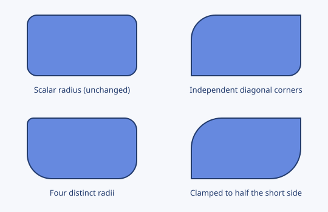

# Independent Rect corner radii

The Rect component now supports four independently rounded corners without
changing its scalar/default behavior. Geometry remains in
`flow-scene/src/display/rect.rs`; the generic vector adapter, CPU compositor,
stroke meshes, picking and engine/editor history consume the same component.

The gallery comes from the executable `rect_corner_gallery` example and each
Rect's `to_path()` output.

## Source and API

The pinned [UI cornerRadius declaration](https://github.com/leaferjs/leafer-ui/blob/1e11641d3ea6b0211c83447268a90b8d58feec25/packages/display/src/UI.ts)
accepts scalar/four-number input; its
[RectHelper fallback](https://github.com/leaferjs/leafer/blob/1d703303ff0759ce4973d54c87eeb8192dddc570/packages/path/src/RectHelper.ts)
normalizes four clockwise radii with a half-short-side ceiling. Kurbo's
`RoundedRect` supplies that normalization, curve construction and
analytic winding test, so this component reuses it instead of implementing new
corner-arc or tessellation algorithms. No upstream code was copied.

- `CornerRadii([top_left, top_right, bottom_right, bottom_left])` is a typed
  four-value array. `CornerRadii::new(...)` and `uniform(radius)` are conveniences.
- `Rect::with_corners([tl, tr, br, bl])` sets `corner_radii: Some(...)`, which
  overrides the existing scalar `corner_radius` for geometry.
- `Rect::rounded(radius)` clears the optional array and restores scalar mode.
  The last builder call therefore determines which mode is active.
- Missing/null `corner_radii` retains the legacy scalar/default path. The optional
  field is omitted when absent, so old scalar JSON serialization remains unchanged.
  New arrays round-trip as exactly four numeric values.
- All input radii must be finite and nonnegative. Each is clamped independently to
  `min(width,height)/2`. This explicitly follows the pinned fallback and existing
  scalar clamp; it does not claim browser-native CSS overlapping-radii scaling,
  percentage strings, two/three-value shorthand or continuous-corner smoothing.
- Nominal and geometry bounds remain the full sizing rectangle. The hit region
  and painted corners change independently, even when those bounds stay identical.

`Rect::to_path()` exports canonical cubic geometry. Per-corner native contours and
CPU paths use those curves; CPU rendering does not fall back to a uniformly
rounded or sharp rectangle. Analytic picking uses Kurbo's corresponding rounded
rectangle. Center/inside/outside strokes retain their existing shared mesh rules.

## Editing, compatibility and limits

The existing `PropertyKey::Shape` transaction changes the component atomically,
including paint/hit invalidation and editor Undo/Redo/cancellation. No new runtime
identity or separate property store is introduced.

Existing constructors, `.rounded`, scalar JSON and legacy scalar flattening are
preserved. New public fields do require external exhaustive Rust struct literals
to be updated; using constructors avoids that source-compatibility issue.
`Rect::flatten` still returns one closed `Contour`, unlike multi-contour Ellipse.

Per-corner dimensions and explicit `to_path()` conversion are bounded to 1000000
local units, 64 curve commands and seven flatten subdivision levels (at most 8192
points). Legacy large scalar rectangles remain valid. Invalid/over-budget inputs
reject at validated mutation boundaries, and existing stroke/compositor budgets
still apply. No extra crate or dependency was introduced.

This original slice was **Rect only**. The later [Box/Frame corner clipping](container-corners.md) slice propagates independent corners through `ClipRegion`, nested vector/CPU clips and native-media eligibility. Validation receipts below describe this Rect slice, not a native-window parity claim.

## Validation

Fresh Linux/Rust 1.98.1 validation on 2026-10-02:

- 18 new Rect regressions pass: 9 scene, 4 engine, 2 editor and 3 CPU pixel tests.
  They cover clockwise independent corners, pinned clamping, analytic hit parity,
  default JSON compatibility, builder precedence, bounds and work limits, aligned
  strokes, real pixels, factory/schema inputs, atomic dirty/hit invalidation and
  editor history/cancellation.
- Two added Ellipse factory regressions also pass. This follow-up exposed and
  corrected the built-in registry schemas so factory creation now accepts the
  earlier Ellipse angle/ring fields as well as Rect corner arrays; invalid values
  reject before insertion. Direct Shape editing was already covered previously.
- Eight headless crates: 826 tests including doctests pass, zero failures, one
  existing ignored radial-raster performance benchmark. Strict all-target Clippy,
  workspace rustfmt and `git diff --check` pass.
- The executable four-shape SVG gallery ran, parsed and was rendered/visually
  inspected. It is component geometry, not a native-window screenshot.

The same [headless validation arrangement](ellipse-arcs.md#validation) applies:
matching source/tests, retained lockfile versions/checksums, and only the copied
flow-text manifest's unused optional GPUI dependency omitted. Repository manifests
and lockfile remain unchanged. Full workspace/native UI/cross-platform checks were
not rerun. No GitHub Actions, deployment or merge was launched.
